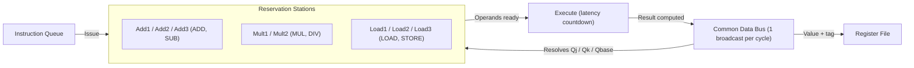
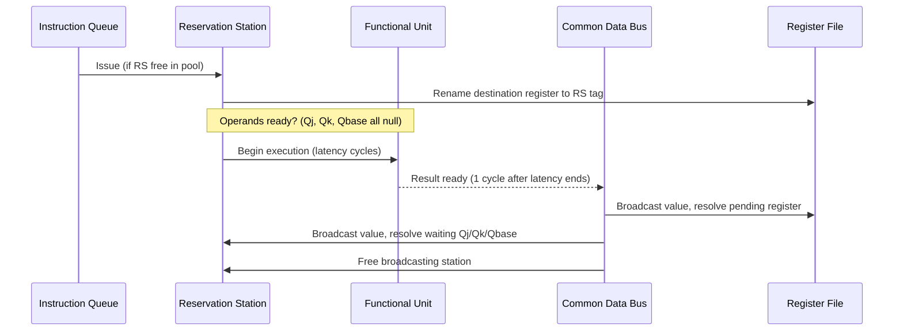
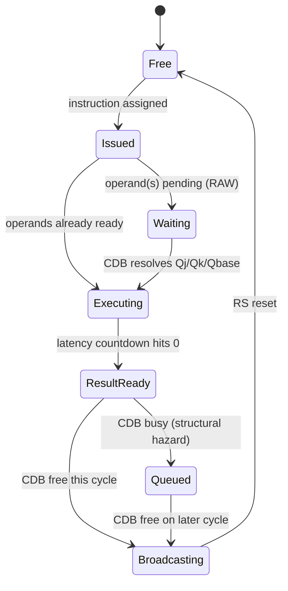

# Tomasulo Visualizer

> An interactive, cycle-accurate simulator of **Tomasulo's Algorithm** — the dynamic scheduling technique that powers out-of-order execution in every modern CPU.

Built with **Next.js**, **React**, and **TypeScript**, with a fully pure, unit-testable simulation engine at its core.

[](https://nextjs.org)
[](https://www.typescriptlang.org)
[](https://react.dev)

**[Source](https://github.com/abhishekpasupathy/tomasulo-visualizer)**

---

## Why This Project

Tomasulo's Algorithm (IBM 360/91, 1967) is the foundation of dynamic instruction scheduling — the reason a modern CPU can execute instructions out of program order without ever producing an incorrect result. It's a core topic in every Computer Architecture course, and notoriously easy to implement incorrectly.

This project doesn't just animate the textbook example — it implements the actual scheduling logic from scratch: reservation stations, register renaming, a common data bus (CDB) with structural-hazard arbitration, and correct handling of all three data hazard types (RAW, WAR, WAW).

## Features

- **Cycle-by-cycle stepping** — watch issue, execute, and writeback unfold one cycle at a time
- **Configurable functional units** — Add/Sub, Multiply, Divide, and Load/Store, each with independent latency
- **Live Gantt timeline** — visual issue/exec/writeback spans per instruction
- **Reservation station table** — see Vj, Vk, Qj, Qk update in real time as the CDB broadcasts
- **Cycle-by-cycle event log** — a full audit trail of every issue, exec-start, exec-end, and writeback event
- **Correct hazard handling**:
  - RAW (Read-After-Write) — instructions stall on Qj/Qk tags until the producing RS broadcasts
  - WAR (Write-After-Read) — resolved via register renaming at issue time, not by stalling
  - WAW (Write-After-Write) — register file only accepts a broadcast if its tag still matches the broadcaster
  - Structural hazards — only one CDB broadcast per cycle, with FIFO/program-order arbitration when multiple functional units finish simultaneously

## Architecture



## One Simulation Cycle

Each STEP action runs the three Tomasulo phases in strict order — each phase sees the results of the one before it, matching real hardware timing:



## Reservation Station Lifecycle



## Tech Stack

| Layer | Technology |
|---|---|
| Framework | Next.js 16 (App Router, Turbopack) |
| Language | TypeScript |
| UI | React 19, Tailwind CSS 4 |
| Simulation engine | Pure functions + reducer pattern (no side effects, fully unit-testable) |
| Deployment | Vercel |

## Project Structure
tomasulo-visualizer/
app/ Next.js App Router pages
components/ UI components (Gantt chart, RS table, register view, etc.)
lib/
types.ts Core type definitions (Instruction, ReservationStation, SimulatorState)
defaults.ts RS pools, latencies, default 6-instruction demo program
simulator.ts The engine: issue / execute / writeback reducer logic
public/

## Functional Unit Latencies

| Operation | Latency (cycles) |
|---|---|
| ADD / SUB | 2 |
| MUL | 10 |
| DIV | 20 |
| LOAD / STORE | 2 |

## Getting Started

```bash
git clone https://github.com/abhishekpasupathy/tomasulo-visualizer.git
cd tomasulo-visualizer
npm install
npm run dev
```

Open http://localhost:3000 to try it.

## Example Program

The default program is the classic Patterson & Hennessy example that deliberately exercises all three hazard types:
LOAD F6, 34(R2) independent
LOAD F2, 45(R3) independent
MUL F0, F2, F4 RAW on F2
SUB F8, F6, F2 RAW on F6, F2
DIV F10, F0, F6 RAW on F0, F6
ADD F6, F8, F2 WAR on F6 - resolved via renaming, not stalling

## License

MIT — feel free to fork and extend.

---

Built by [Abhishek Pasupathy](https://github.com/abhishekpasupathy) as a deep-dive into out-of-order execution and dynamic instruction scheduling.
